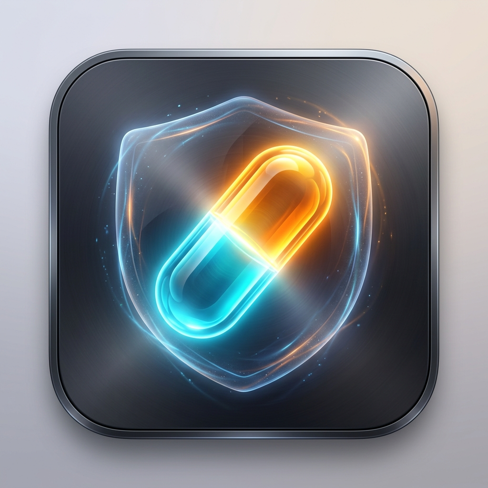

# 💊 Dopamine for Mac (Apple Silicon Edition)

<p align="center">
  
</p>

<p align="center">
  <strong>Next-Generation macOS Keep-Awake Utility with True 0.0-Nit Closed-Lid Display Backlight Cutoff.</strong><br>
  <em>The modern, privacy-first successor to Caffeine and Amphetamine engineered for Apple Silicon (M1/M2/M3/M4).</em>
</p>

<p align="center">
  <a href="https://dopamine.33rd.pro"></a>
  <a href="https://github.com/UniversalSDK/Dopamine/releases"></a>
  
  
  
  
</p>

---

## ⚡️ Why Dopamine?

Legacy utilities like **Amphetamine**, **Caffeine**, and **KeepingYouAwake** were architected for older Intel laptops. On modern MacBook Pro and MacBook Air models with **Liquid Retina XDR and Mini-LED displays**, they create dangerous thermal traps:

1. **Trapped Mini-LED Heat:** When closing the lid with legacy tools active, the screen remains fully powered on, radiating heat directly into the keyboard and accelerating anti-reflective screen coating degradation.
2. **Wasted Battery:** Powering millions of invisible pixels wastes 15–30% more battery every hour.
3. **Cables Required:** macOS native clamshell requires an external power adapter and monitor just to stay awake.

### 🛡️ The Dopamine Dual-Engine Solution
* **Zero-Nit Hardware Backlight Cutoff:** Direct `DisplayServices` and `IOKit` hardware register calls cut the internal display backlight down to **absolute 0.0 nits** the millisecond the lid closes.
* **Continuous Compute:** Long-running compiles, AI fine-tuning, 3D renders, video exports, and downloads execute at peak Apple Silicon performance inside your backpack or on your desk with the lid shut.
* **Cold Screen, Zero Heat Traps:** The Liquid Retina panel stays completely cold. Opening the lid instantly restores display brightness.

---

## 🚀 Installation

### 1. Direct Download
* **[Download Dopamine.dmg (Apple Silicon)](https://dopamine.33rd.pro/Dopamine.dmg)**
* **[Download Enterprise PKG Installer](https://dopamine.33rd.pro/Dopamine-Installer.pkg)**

### 2. Homebrew Cask
```bash
brew tap UniversalSDK/dopamine
brew install --cask dopamine
```

---

## 🌟 Key Features

* **⚡️ One-Click Awake Sessions:** Keep awake Indefinitely, or for timed sessions (15m, 30m, 45m, 1h, 2h, or Custom duration).
* **💊 6 Native Menu Bar Icon Styles:** Choose between Pill/Capsule, Eye, Lightning Bolt, Shield, Sun/Moon, and Coffee Cup (SF Symbols native).
* **🔋 Intelligent Battery Safeguard:** Automatically releases sleep assertions if battery drops below a user-defined threshold (e.g. 20%).
* **🌍 11 Native Languages:** Built-in seamless translation for English, Українська, Deutsch, Français, 日本語, Español, 简体中文, Italiano, Português, 한국어, and Русский.
* **🔒 Privacy-First:** 0% idle CPU overhead, Hardened Runtime, and zero telemetry without consent.

---

## 🛠 Building from Source

```bash
git clone https://github.com/UniversalSDK/Dopamine.git
cd Dopamine
./build.sh
./package.sh
```

---

## 📄 License

Distributed under the MIT License. See `LICENSE` for more information.

<p align="center">
  Crafted with care for MacBook Pro & MacBook Air users worldwide.
</p>
